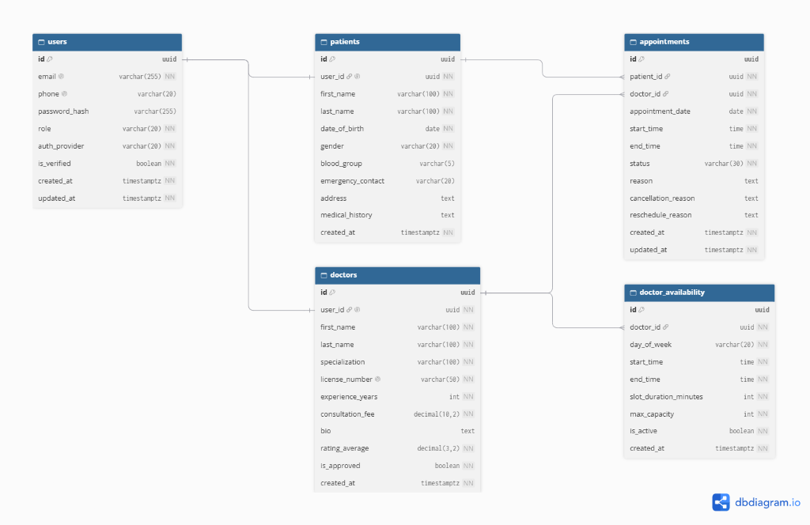

# Schedula - Hospital Management System (Schedule Project Module)

Welcome to the **Schedule Project Module** repository for **Schedula**, developed for the **PearlThoughts Internship Programme**.

This branch (`feature/schedule-er-diagram`) contains the complete ER Diagram specification, the Loom video walkthrough, and a starter **Next.js 15** frontend application.

---

## 📹 Video Walkthrough

Watch the complete explanation of the Schedule Project Module ER Diagram on Loom:  
👉 **[Watch Video Explanation on Loom](https://www.loom.com/share/9fd476977c814355898fb42bc4f835ad)**

---

## 🗺️ Entity-Relationship Diagram (dbdiagram.io)

Below is the verified ER Diagram covering the **5 core modules in sequential order**:



### Core Modules in Order:
1. **User Module** (`users`): Authentication, Google OAuth, and role management (`DOCTOR`, `PATIENT`, `ADMIN`).
2. **Patient Module** (`patients`): Patient clinical demographics, emergency contact, and baseline medical history (`1:1` with `users`).
3. **Doctor Module** (`doctors`): Medical credentials, license verification, consultation fees, and ratings (`1:1` with `users`).
4. **Availability Module** (`doctor_availability`): Recurring shift windows and elastic buffer capacity for doctors (`1:N` with `doctors`).
5. **Appointment Module** (`appointments`): Booking transaction linking patient and doctor with cancellation & reschedule tracking.

---

## 💻 Next.js 15 Frontend Application

A modern "Hello World" Next.js web application is set up in [`frontend/`](./frontend).

### Running Locally:
```bash
cd frontend
npm install
npm run dev
```
Open [http://localhost:3000](http://localhost:3000) in your browser.

### Building for Production:
```bash
cd frontend
npm run build
```

---

## 🚀 How to Open in dbdiagram.io

1. Go to **[dbdiagram.io](https://dbdiagram.io)**.
2. Click **+ New Diagram**.
3. Open [`docs/schema.dbml`](./docs/schema.dbml), copy the DBML code, and paste it into the editor.
4. The diagram renders immediately with all 5 entities and relationships!

---

## 📄 Standalone PDF Deliverable

The high-resolution vector PDF is saved at:  
👉 **[`Schedula_Schedule_Module_ERD.pdf`](./Schedula_Schedule_Module_ERD.pdf)**

---

## 📂 Project Structure

```
.
├── Schedula_Schedule_Module_ERD.pdf   # High-resolution vector PDF deliverable
├── README.md                          # Repository summary, ER diagram & Loom link
├── generate_erd_pdf.py                # Python PDF generation script
├── frontend/                          # Next.js 15 Hello World application
│   ├── src/app/page.tsx               # Landing page with video & module links
│   ├── package.json
│   └── tsconfig.json
└── docs/
    ├── schedula_er_diagram.png        # dbdiagram.io exported ER Diagram image
    ├── schema.dbml                    # DBML schema code for dbdiagram.io
    ├── ERD_Schedule_Module.md         # Full specification & data dictionary
    ├── erd_preview.html               # Interactive browser preview
    └── erd_print.html                 # Print template
```
