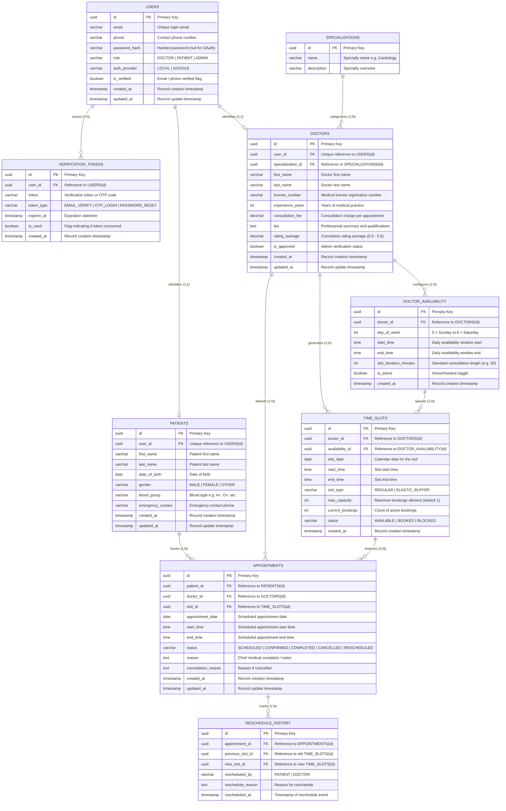

# Schedula - Hospital Management System (Schedule Project Module)

Welcome to the **Schedule Project Module** repository for the **Schedula** Healthcare Management System, developed as part of the **PearlThoughts Internship Programme**.

This project provides the database schema architecture, Entity-Relationship (ER) specification, and implementation blueprint based on the [PearlThoughts Weekly Development Plans](https://github.com/PearlThoughtsInternship/Internship-Obsidian-Vault/blob/main/Programme-Structure/Weekly-Plans.md).

---

## 📋 Task Requirements & Deliverable Summary

As mandated by the internship assignment, the ER Diagram is designed to be **simple, clear, and easy to understand**, systematically covering the five project modules in sequence:

1. **User Module** (Authentication, roles, verification tokens)
2. **Patient Module** (Patient identity, baseline demographic data)
3. **Doctor Module** (Medical licenses, specializations, consultation fees)
4. **Availability Module** (Weekly availability schedules, elastic time slots)
5. **Appointment Module** (Bookings, status transitions, reschedule history)

---

## 🗺️ Entity-Relationship Diagram (ERD)



---

## 📂 Project Structure

```
.
├── Schedula_Schedule_Module_ERD.pdf   # Standalone print-ready PDF deliverable
├── README.md                          # Main project summary & ER diagram
├── package.json                       # Package manifest
├── server.js                          # Local viewer server
├── generate_erd_pdf.py                # Python PDF generation script
└── docs/
    ├── schema.dbml                    # DBML schema code for dbdiagram.io
    ├── ERD_Schedule_Module.md         # Full data dictionary & 3NF technical spec
    ├── erd_preview.html               # Interactive viewer with pan/zoom & SVG export
    └── erd_print.html                 # Print-optimized HTML template
```

---

## 🔍 How to View & Present the ER Diagram

1. **dbdiagram.io (Interactive Online ERD)**:
   - Go to **[dbdiagram.io](https://dbdiagram.io)**.
   - Click **+ New Diagram**.
   - Copy the contents of [`docs/schema.dbml`](./docs/schema.dbml) and paste it into the editor.
   - The diagram will automatically render with color-coded module groups, cardinalities, and field notes!

2. **Standalone PDF Document**:
   - Open [`Schedula_Schedule_Module_ERD.pdf`](./Schedula_Schedule_Module_ERD.pdf) in any PDF reader for high-resolution 300 DPI vector rendering.

3. **Interactive Local Browser View**:
   - Double-click or open `docs/erd_preview.html` in any browser.
   - Use the pan/zoom controls or mouse wheel to navigate, and click **Export SVG** to save a vector diagram for presentation slides or reports.

4. **Markdown / Obsidian View**:
   - Open `docs/ERD_Schedule_Module.md` in GitHub, Obsidian, or VS Code Markdown Preview. Mermaid diagrams render natively.

---

## 🎯 Alignment with Internship Weekly Plans

| Internship Week | Milestone Focus | Related Entities in this ERD |
|---|---|---|
| **Week 1** | Registration, Authentication & Onboarding | `USERS`, `VERIFICATION_TOKENS`, `PATIENTS`, `DOCTORS` |
| **Week 2** | Appointment Making & Doctor Management | `DOCTORS`, `SPECIALIZATIONS`, `TIME_SLOTS`, `APPOINTMENTS` |
| **Week 3** | Elastic Scheduling & Reschedule Experience | `DOCTOR_AVAILABILITY`, `TIME_SLOTS` (`ELASTIC_BUFFER`), `RESCHEDULE_HISTORY` |
| **Week 4** | Re-engagement & Audit Logging | `APPOINTMENTS` (`status` transitions), `RESCHEDULE_HISTORY` |
