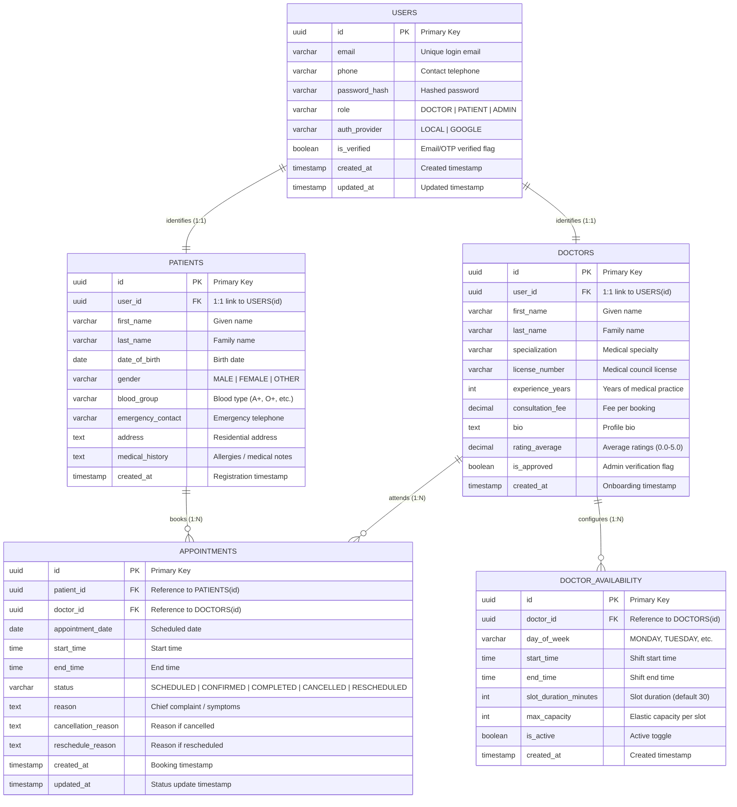

# Schedula - Hospital Management System (Schedule Project Module)

Welcome to the **Schedule Project Module** ER diagram for **Schedula**, developed for the **PearlThoughts Internship Programme**.

This ER diagram covers the **five project modules in exact sequential order**, with comprehensive attributes inside each entity:

1. **User Module** (`USERS`)
2. **Patient Module** (`PATIENTS`)
3. **Doctor Module** (`DOCTORS`)
4. **Availability Module** (`DOCTOR_AVAILABILITY`)
5. **Appointment Module** (`APPOINTMENTS`)

---

## 🗺️ Entity-Relationship Diagram



---

## 🚀 How to Open in dbdiagram.io

1. Go to **[dbdiagram.io](https://dbdiagram.io)**.
2. Click **+ New Diagram**.
3. Open [`docs/schema.dbml`](./docs/schema.dbml), copy the DBML code, and paste it into the editor.
4. The diagram renders immediately with all 5 modules, fields, notes, and relationships!

---

## 📄 Standalone PDF Deliverable

The high-resolution vector PDF is saved at:  
👉 **[`Schedula_Schedule_Module_ERD.pdf`](./Schedula_Schedule_Module_ERD.pdf)**

---

## 📂 Project Structure

```
.
├── Schedula_Schedule_Module_ERD.pdf   # High-resolution vector PDF deliverable
├── README.md                          # Repository summary & Mermaid ERD
├── generate_erd_pdf.py                # Python PDF generation script
└── docs/
    ├── schema.dbml                    # DBML schema code for dbdiagram.io
    ├── ERD_Schedule_Module.md         # Full specification & data dictionary
    ├── erd_preview.html               # Interactive browser preview
    └── erd_print.html                 # Print template
```
