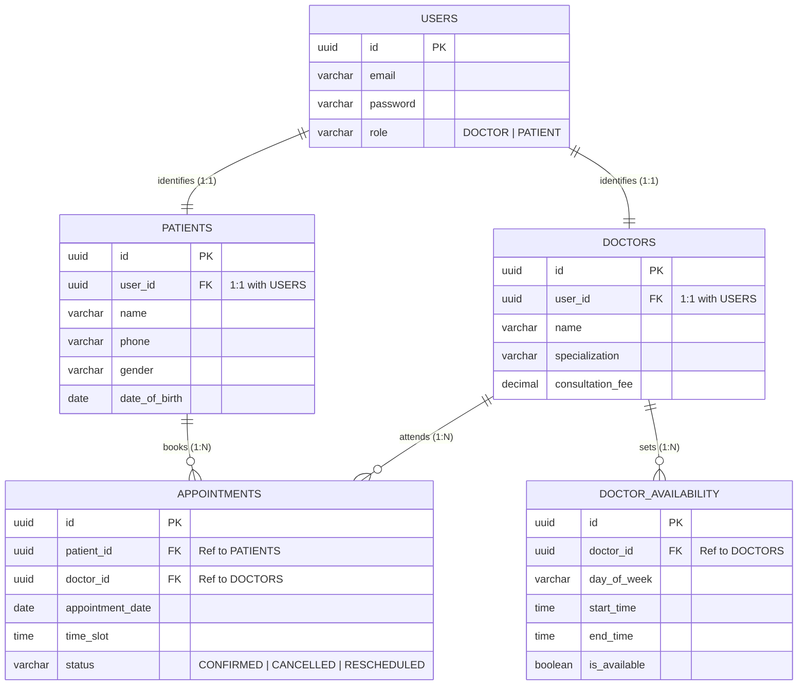

# Simple ER Diagram Specification: Schedule Project Module

## 1. Overview
This is a **simple, clear, and easy-to-understand** Entity-Relationship (ER) diagram for the **Schedule Project Module** of the Healthcare Management System (**Schedula**), aligned with the PearlThoughts Internship requirements.

It covers the **five core modules in exact sequential order**:
1. **User Module** (`users`)
2. **Patient Module** (`patients`)
3. **Doctor Module** (`doctors`)
4. **Availability Module** (`doctor_availability`)
5. **Appointment Module** (`appointments`)

---

## 2. Simple ER Diagram

---

## 3. Module Overview

| # | Module | Entity Name | Description | Key Relationships |
|---|---|---|---|---|
| **1** | **User Module** | `USERS` | Handles user authentication and roles (`DOCTOR`, `PATIENT`). | 1:1 with `PATIENTS` and `DOCTORS` |
| **2** | **Patient Module** | `PATIENTS` | Holds patient profile information (name, phone, gender, DOB). | Belongs to 1 User; Books Many Appointments |
| **3** | **Doctor Module** | `DOCTORS` | Stores doctor profile, specialty, and consultation charges. | Belongs to 1 User; Attends Many Appointments |
| **4** | **Availability Module** | `DOCTOR_AVAILABILITY` | Defines weekly availability slots for each doctor. | Belongs to 1 Doctor (1:N) |
| **5** | **Appointment Module** | `APPOINTMENTS` | Records scheduled appointments between patients and doctors. | Connects Patient (N:1) & Doctor (N:1) |

---

## 4. Key Relationships Explained Simply
* **User &rarr; Patient (`1:1`)**: Every patient is a registered user.
* **User &rarr; Doctor (`1:1`)**: Every doctor is a registered user.
* **Doctor &rarr; Availability (`1:N`)**: A doctor sets multiple available days and consultation windows.
* **Patient &rarr; Appointment (`1:N`)**: A patient can book multiple appointments over time.
* **Doctor &rarr; Appointment (`1:N`)**: A doctor can have multiple scheduled appointments.
