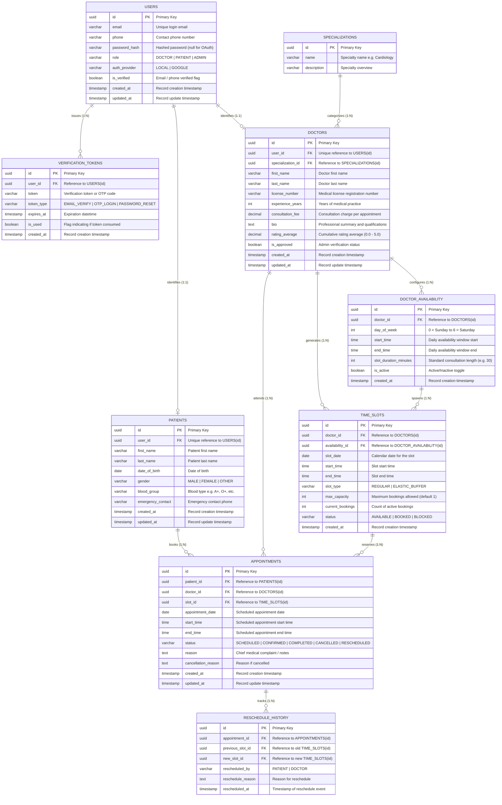

# Entity-Relationship (ER) Specification: Schedule Project Module

## 1. Overview
This document specifies the database design and Entity-Relationship (ER) architecture for the **Schedule Project Module** of the Healthcare Management System (**Schedula**), aligned with the PearlThoughts Internship weekly milestones.

The schema is organized into **five core modules in sequential order**:
1. **User Module** (Authentication, Authorization & Role Management)
2. **Patient Module** (Patient Profiles & Medical Baseline)
3. **Doctor Module** (Professional Profile, Credentials & Specialization)
4. **Availability Module** (Doctor Weekly Schedules & Elastic Time Slots)
5. **Appointment Module** (Bookings, Status Lifecycle & Reschedule Audit)

---

## 2. Complete Entity-Relationship Diagram (ERD)

---

## 3. Detailed Module Breakdown

### 3.1. User Module
**Objective:** Provide authentication, secure authorization, Google OAuth support, and role-based access control.

* **`USERS` Table**:
  - Serves as the single source of truth for authentication credentials.
  - Keeps identity decoupled from role-specific clinical logic (clean separation of concerns).
  - Supports both standard password-based sign-in and Google OAuth login via `auth_provider`.
  - Roles supported: `PATIENT`, `DOCTOR`, `ADMIN`.

* **`VERIFICATION_TOKENS` Table**:
  - Manages OTPs, email confirmation codes, and password recovery tokens.
  - Contains `expires_at` and `is_used` for replay attack prevention.

---

### 3.2. Patient Module
**Objective:** Manage patient profile data, demographic details, and emergency contacts.

* **`PATIENTS` Table**:
  - Linked to `USERS` with a strict `1:1` foreign key relationship (`user_id`).
  - Holds non-auth demographic data: `first_name`, `last_name`, `date_of_birth`, `gender`, `blood_group`, and `emergency_contact`.
  - Maintains referential integrity when patients book appointments.

---

### 3.3. Doctor Module
**Objective:** Handle doctor onboarding, verification of professional licenses, and medical specialties.

* **`DOCTORS` Table**:
  - Linked to `USERS` with a strict `1:1` foreign key relationship (`user_id`).
  - Stores medical credentials: `license_number`, `experience_years`, `consultation_fee`, `bio`, and `rating_average`.
  - `is_approved` boolean flag allows hospital administrators to verify doctor credentials before they can receive bookings.

* **`SPECIALIZATIONS` Table**:
  - Normalized table of specialties (e.g., General Medicine, Cardiology, Dermatology, Pediatrics).
  - Referenced by doctors via `specialization_id` (`1:N`).

---

### 3.4. Availability Module
**Objective:** Allow doctors to define recurring consultation schedules and generate discrete booking slots with support for elastic capacity.

* **`DOCTOR_AVAILABILITY` Table**:
  - Defines recurring weekly availability rules (e.g., Monday through Friday, 09:00 to 17:00, 30-minute intervals).
  - Allows doctors to quickly configure their weekly routine.

* **`TIME_SLOTS` Table**:
  - Represents the concrete, bookable calendar slots for specific dates (`slot_date`, `start_time`, `end_time`).
  - **Elastic Scheduling Support**: Includes `slot_type` (`REGULAR` vs `ELASTIC_BUFFER`), `max_capacity` (allows doctors to expand capacity for walk-ins or overbooking if needed), and `current_bookings`.
  - Contains status flag (`AVAILABLE`, `BOOKED`, `BLOCKED`).

---

### 3.5. Appointment Module
**Objective:** Facilitate patient booking, doctor consultation workflows, cancellation, and reschedule auditing.

* **`APPOINTMENTS` Table**:
  - Core transaction entity linking `PATIENTS`, `DOCTORS`, and `TIME_SLOTS`.
  - State machine tracked via `status`:
    - `SCHEDULED` $\rightarrow$ Initial booking.
    - `CONFIRMED` $\rightarrow$ Doctor / automated acceptance.
    - `COMPLETED` $\rightarrow$ Consultation concluded.
    - `CANCELLED` $\rightarrow$ Cancelled by doctor or patient with `cancellation_reason`.
    - `RESCHEDULED` $\rightarrow$ Shifted to a new time slot.

* **`RESCHEDULE_HISTORY` Table**:
  - Maintains a full historical audit trail whenever an appointment is shifted.
  - Links to `APPOINTMENTS`, referencing `previous_slot_id` and `new_slot_id`.
  - Captures `rescheduled_by` (`PATIENT` or `DOCTOR`) and the `reschedule_reason` for hospital analytics.

---

## 4. Data Dictionary & Schema Specification

| Table | Column | Type | Constraints | Description |
|---|---|---|---|---|
| **users** | `id` | UUID | PK, Default `gen_random_uuid()` | Unique user identifier |
| | `email` | VARCHAR(255) | UNIQUE, NOT NULL | Account email |
| | `phone` | VARCHAR(20) | NULLABLE | Phone number for SMS/OTP |
| | `password_hash` | VARCHAR(255) | NULLABLE | Nullable for OAuth accounts |
| | `role` | VARCHAR(20) | NOT NULL, Check IN ('DOCTOR', 'PATIENT', 'ADMIN') | Access control role |
| | `auth_provider` | VARCHAR(20) | NOT NULL, Default 'LOCAL' | 'LOCAL' or 'GOOGLE' |
| | `is_verified` | BOOLEAN | NOT NULL, Default FALSE | Identity verification status |
| | `created_at` | TIMESTAMPTZ | NOT NULL, Default `NOW()` | Timestamp created |
| | `updated_at` | TIMESTAMPTZ | NOT NULL, Default `NOW()` | Timestamp updated |
| **verification_tokens** | `id` | UUID | PK, Default `gen_random_uuid()` | Unique token identifier |
| | `user_id` | UUID | FK -> `users(id)`, ON DELETE CASCADE | Target user |
| | `token` | VARCHAR(255) | NOT NULL | OTP or hash token |
| | `token_type` | VARCHAR(50) | NOT NULL | Token category |
| | `expires_at` | TIMESTAMPTZ | NOT NULL | Expiry datetime |
| | `is_used` | BOOLEAN | NOT NULL, Default FALSE | Consumed flag |
| **patients** | `id` | UUID | PK, Default `gen_random_uuid()` | Patient identifier |
| | `user_id` | UUID | FK -> `users(id)`, UNIQUE, ON DELETE CASCADE | 1:1 link to User |
| | `first_name` | VARCHAR(100) | NOT NULL | Given name |
| | `last_name` | VARCHAR(100) | NOT NULL | Family name |
| | `date_of_birth` | DATE | NOT NULL | Birth date |
| | `gender` | VARCHAR(20) | NOT NULL | Gender |
| | `blood_group` | VARCHAR(5) | NULLABLE | Blood category |
| | `emergency_contact`| VARCHAR(20) | NULLABLE | Contact telephone |
| **specializations** | `id` | UUID | PK, Default `gen_random_uuid()` | Specialization identifier |
| | `name` | VARCHAR(100) | UNIQUE, NOT NULL | Medical specialty name |
| | `description` | TEXT | NULLABLE | Overview |
| **doctors** | `id` | UUID | PK, Default `gen_random_uuid()` | Doctor identifier |
| | `user_id` | UUID | FK -> `users(id)`, UNIQUE, ON DELETE CASCADE | 1:1 link to User |
| | `specialization_id`| UUID | FK -> `specializations(id)`, ON DELETE RESTRICT | Medical field |
| | `first_name` | VARCHAR(100) | NOT NULL | Given name |
| | `last_name` | VARCHAR(100) | NOT NULL | Family name |
| | `license_number` | VARCHAR(50) | UNIQUE, NOT NULL | Medical council registration |
| | `experience_years` | INT | NOT NULL, Default 0 | Practice years |
| | `consultation_fee` | DECIMAL(10,2)| NOT NULL, Default 0.00 | Fee per booking |
| | `bio` | TEXT | NULLABLE | Biography / background |
| | `rating_average` | DECIMAL(3,2) | NOT NULL, Default 0.00 | Average feedback rating |
| | `is_approved` | BOOLEAN | NOT NULL, Default FALSE | Admin credential validation |
| **doctor_availability**| `id` | UUID | PK, Default `gen_random_uuid()` | Availability identifier |
| | `doctor_id` | UUID | FK -> `doctors(id)`, ON DELETE CASCADE | Target doctor |
| | `day_of_week` | SMALLINT | NOT NULL, Check 0..6 | 0=Sun, 1=Mon, ..., 6=Sat |
| | `start_time` | TIME | NOT NULL | Consultation window start |
| | `end_time` | TIME | NOT NULL | Consultation window end |
| | `slot_duration_minutes`| INT | NOT NULL, Default 30 | Granularity per slot |
| | `is_active` | BOOLEAN | NOT NULL, Default TRUE | Active flag |
| **time_slots** | `id` | UUID | PK, Default `gen_random_uuid()` | Slot identifier |
| | `doctor_id` | UUID | FK -> `doctors(id)`, ON DELETE CASCADE | Doctor offering slot |
| | `availability_id` | UUID | FK -> `doctor_availability(id)`, NULLABLE | Parent schedule rule |
| | `slot_date` | DATE | NOT NULL | Calendar date |
| | `start_time` | TIME | NOT NULL | Slot start |
| | `end_time` | TIME | NOT NULL | Slot end |
| | `slot_type` | VARCHAR(30) | NOT NULL, Default 'REGULAR' | 'REGULAR' or 'ELASTIC_BUFFER' |
| | `max_capacity` | INT | NOT NULL, Default 1 | Max concurrent bookings |
| | `current_bookings`| INT | NOT NULL, Default 0 | Active bookings count |
| | `status` | VARCHAR(20) | NOT NULL, Default 'AVAILABLE' | 'AVAILABLE', 'BOOKED', 'BLOCKED' |
| **appointments** | `id` | UUID | PK, Default `gen_random_uuid()` | Appointment identifier |
| | `patient_id` | UUID | FK -> `patients(id)`, ON DELETE CASCADE | Patient attending |
| | `doctor_id` | UUID | FK -> `doctors(id)`, ON DELETE CASCADE | Doctor attending |
| | `slot_id` | UUID | FK -> `time_slots(id)`, ON DELETE RESTRICT | Reserved slot |
| | `appointment_date`| DATE | NOT NULL | Date of consultation |
| | `start_time` | TIME | NOT NULL | Start time |
| | `end_time` | TIME | NOT NULL | End time |
| | `status` | VARCHAR(30) | NOT NULL, Default 'SCHEDULED' | Lifecycle status |
| | `reason` | TEXT | NULLABLE | Patient symptoms/notes |
| | `cancellation_reason` | TEXT | NULLABLE | Reason if cancelled |
| **reschedule_history** | `id` | UUID | PK, Default `gen_random_uuid()` | History log identifier |
| | `appointment_id` | UUID | FK -> `appointments(id)`, ON DELETE CASCADE | Subject appointment |
| | `previous_slot_id`| UUID | FK -> `time_slots(id)`, ON DELETE SET NULL | Replaced time slot |
| | `new_slot_id` | UUID | FK -> `time_slots(id)`, ON DELETE SET NULL | New time slot |
| | `rescheduled_by` | VARCHAR(20) | NOT NULL | 'PATIENT' or 'DOCTOR' |
| | `reschedule_reason`| TEXT | NULLABLE | Motivation for change |
| | `rescheduled_at` | TIMESTAMPTZ | NOT NULL, Default `NOW()` | Timestamp of modification |

---

## 5. Design Decisions & Industry Best Practices

1. **Third Normal Form (3NF) Compliance**:
   - Redundancy is minimized. User identity (emails, credentials) is completely decoupled from domain entities (`patients`, `doctors`).
   - Doctors can belong to normalized medical specializations without duplicated strings.

2. **Concurrency & Double-Booking Prevention**:
   - `time_slots` includes `max_capacity` and `current_bookings` with transactional locks (`SELECT FOR UPDATE` in NestJS/TypeORM/Prisma) to ensure no slot exceeds capacity under high concurrency.

3. **Auditability & Traceability**:
   - When an appointment is rescheduled or cancelled, records are never quietly overwritten. `reschedule_history` preserves audit metrics to inform clinic management and patient re-engagement algorithms.

4. **Elastic Scheduling Ready**:
   - Built directly to support Week 3's requirement for doctors to expand capacity dynamically during busy hospital shifts through `ELASTIC_BUFFER` slot types.
