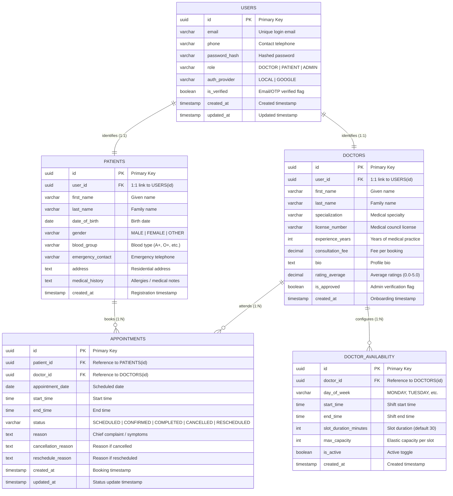

# Schedule Project Module: Entity-Relationship (ER) Specification

## 1. Overview
This document specifies the database architecture for the **Schedule Project Module** of the Healthcare Management System (**Schedula**), aligned with the PearlThoughts Internship weekly milestones.

The architecture covers the **five core modules in exact sequential order** across 5 focused entities with full clinical, authentication, and operational attributes:
1. **User Module** (`USERS`)
2. **Patient Module** (`PATIENTS`)
3. **Doctor Module** (`DOCTORS`)
4. **Availability Module** (`DOCTOR_AVAILABILITY`)
5. **Appointment Module** (`APPOINTMENTS`)

---

## 2. Complete Entity-Relationship Diagram

---

## 3. Data Dictionary & Column Specifications

| Table | Column Name | Data Type | Constraints | Description |
|---|---|---|---|---|
| **users** | `id` | UUID | PK, `gen_random_uuid()` | Unique user account identifier |
| | `email` | VARCHAR(255) | UNIQUE, NOT NULL | Account login email |
| | `phone` | VARCHAR(20) | UNIQUE, NULLABLE | Contact telephone for OTP verification |
| | `password_hash` | VARCHAR(255) | NULLABLE | Password hash (nullable for Google OAuth) |
| | `role` | VARCHAR(20) | NOT NULL | `DOCTOR`, `PATIENT`, or `ADMIN` |
| | `auth_provider`| VARCHAR(20) | NOT NULL, Default 'LOCAL'| `LOCAL` or `GOOGLE` |
| | `is_verified` | BOOLEAN | NOT NULL, Default FALSE | Identity verification status |
| | `created_at` | TIMESTAMPTZ | NOT NULL, Default `NOW()` | Account creation timestamp |
| | `updated_at` | TIMESTAMPTZ | NOT NULL, Default `NOW()` | Account update timestamp |
| **patients** | `id` | UUID | PK, `gen_random_uuid()` | Unique patient identifier |
| | `user_id` | UUID | FK -> `users(id)`, UNIQUE | 1:1 foreign key reference to User |
| | `first_name` | VARCHAR(100) | NOT NULL | Given name |
| | `last_name` | VARCHAR(100) | NOT NULL | Family name |
| | `date_of_birth`| DATE | NOT NULL | Date of birth |
| | `gender` | VARCHAR(20) | NOT NULL | `MALE`, `FEMALE`, or `OTHER` |
| | `blood_group` | VARCHAR(5) | NULLABLE | Blood group (e.g. A+, O+, etc.) |
| | `emergency_contact`| VARCHAR(20)| NULLABLE | Emergency telephone number |
| | `address` | TEXT | NULLABLE | Residential postal address |
| | `medical_history`| TEXT | NULLABLE | Allergies, chronic conditions, and notes |
| | `created_at` | TIMESTAMPTZ | NOT NULL, Default `NOW()` | Registration timestamp |
| **doctors** | `id` | UUID | PK, `gen_random_uuid()` | Unique doctor identifier |
| | `user_id` | UUID | FK -> `users(id)`, UNIQUE | 1:1 foreign key reference to User |
| | `first_name` | VARCHAR(100) | NOT NULL | Given name |
| | `last_name` | VARCHAR(100) | NOT NULL | Family name |
| | `specialization`| VARCHAR(100)| NOT NULL | Medical specialty (e.g. Cardiology, Pediatrics) |
| | `license_number`| VARCHAR(50) | UNIQUE, NOT NULL | Medical council license registration |
| | `experience_years`| INT | NOT NULL, Default 0 | Years of active medical practice |
| | `consultation_fee`| DECIMAL(10,2)| NOT NULL, Default 0.00 | Fee charged per consultation |
| | `bio` | TEXT | NULLABLE | Professional summary and background |
| | `rating_average`| DECIMAL(3,2) | NOT NULL, Default 0.00 | Average patient feedback rating (0.0 to 5.0) |
| | `is_approved` | BOOLEAN | NOT NULL, Default FALSE | Admin credential verification status |
| | `created_at` | TIMESTAMPTZ | NOT NULL, Default `NOW()` | Onboarding timestamp |
| **doctor_availability**| `id`| UUID | PK, `gen_random_uuid()` | Availability slot identifier |
| | `doctor_id` | UUID | FK -> `doctors(id)`, CASCADE | Reference to attending doctor |
| | `day_of_week` | VARCHAR(20) | NOT NULL | Day of week (`MONDAY`, `TUESDAY`, etc.) |
| | `start_time` | TIME | NOT NULL | Shift start time |
| | `end_time` | TIME | NOT NULL | Shift end time |
| | `slot_duration_minutes`| INT | NOT NULL, Default 30 | Granularity per slot (minutes) |
| | `max_capacity` | INT | NOT NULL, Default 1 | Max concurrent bookings (Elastic scheduling) |
| | `is_active` | BOOLEAN | NOT NULL, Default TRUE | Active toggle |
| | `created_at` | TIMESTAMPTZ | NOT NULL, Default `NOW()` | Created timestamp |
| **appointments**| `id` | UUID | PK, `gen_random_uuid()` | Unique appointment identifier |
| | `patient_id` | UUID | FK -> `patients(id)`, CASCADE | Reference to booking patient |
| | `doctor_id` | UUID | FK -> `doctors(id)`, CASCADE | Reference to attending doctor |
| | `appointment_date`| DATE | NOT NULL | Date of consultation |
| | `start_time` | TIME | NOT NULL | Consultation start time |
| | `end_time` | TIME | NOT NULL | Consultation end time |
| | `status` | VARCHAR(30) | NOT NULL, Default 'SCHEDULED' | `SCHEDULED`, `CONFIRMED`, `COMPLETED`, `CANCELLED`, `RESCHEDULED` |
| | `reason` | TEXT | NULLABLE | Chief medical complaint and symptoms |
| | `cancellation_reason`| TEXT | NULLABLE | Explanation if appointment cancelled |
| | `reschedule_reason`| TEXT | NULLABLE | Explanation if appointment rescheduled |
| | `created_at` | TIMESTAMPTZ | NOT NULL, Default `NOW()` | Booking created timestamp |
| | `updated_at` | TIMESTAMPTZ | NOT NULL, Default `NOW()` | Status update timestamp |

---

## 4. Key Architectural Decisions
1. **Identity Decoupling (`users` vs `patients`/`doctors`)**: Separates authentication (OAuth, password hash, role) from domain clinical profiles via `1:1` foreign keys.
2. **Elastic Capacity Support**: `doctor_availability.max_capacity` accommodates dynamic expansion of appointment capacity for walk-ins or peak hospital shifts.
3. **Auditability**: `appointments` records reasons for booking, cancellation, and rescheduling directly to support full audit tracing and re-engagement metrics.
