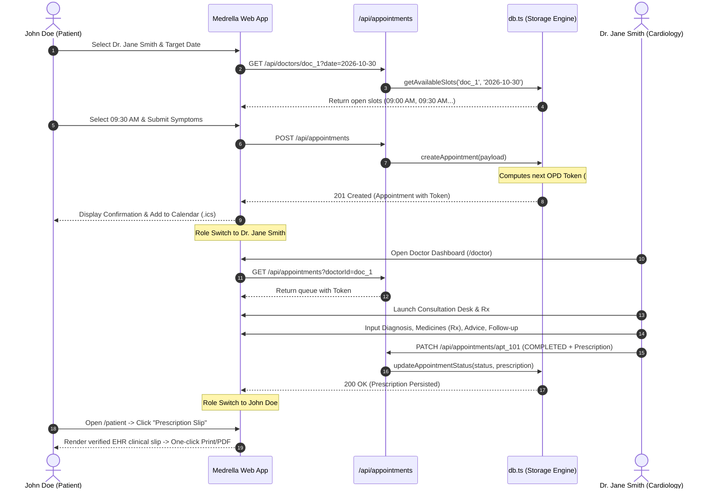

# 🏗️ System Architecture & Design Specification

## 1. High-Level Architecture

Medrella HMS is engineered as a unified Next.js 16 App Router application combining a high-performance React 19 client frontend with serverless API route handlers.

```mermaid
flowchart TD
    subgraph Browser Client
        UI[Next.js Client Components]
        ThemeCtx[Theme Context - Light / Dark]
        RoleCtx[Role Persona Context]
        CalSync[RFC 5545 .ics Calendar Generator]
        PrintEngine[Print / PDF Slip Generator]
    end

    subgraph Next.js 16 App Router
        HomeRoute["/ (Landing Page & Hero)"]
        DoctorsRoute["/doctors (Specialist Discovery)"]
        PatientRoute["/patient (Patient Portal)"]
        DoctorRoute["/doctor (OPD Queue Dashboard)"]
    end

    subgraph REST Backend Route Handlers
        DocAPI["/api/doctors (List & Detail)"]
        ApptAPI["/api/appointments (Booking Engine)"]
        ApptDetailAPI["/api/appointments/[id] (Patch Status & Rx)"]
        AvailAPI["/api/availability (Shift Rules)"]
    end

    subgraph Data & Persistence Layer
        MemCache["In-Memory Database Cache"]
        LocalFile[".data/db.json (Local Dev Disk)"]
        VercelTmp["/tmp/db.json (Serverless Scratchpad)"]
    end

    UI --> Next.js 16 App Router
    UI --> ThemeCtx
    UI --> RoleCtx
    UI --> CalSync
    UI --> PrintEngine

    Next.js 16 App Router --> REST Backend Route Handlers
    REST Backend Route Handlers --> MemCache
    MemCache --> LocalFile
    MemCache --> VercelTmp
```

---

## 2. Component Hierarchy & Routing

```
frontend/src/
├── app/
│   ├── layout.tsx             # Root layout with ThemeProvider & RoleProvider
│   ├── page.tsx               # Marketing landing page with live OPD showcase
│   ├── globals.css            # Tailwind CSS v4 styling & dark variant
│   ├── doctors/page.tsx       # Specialist directory with search & filters
│   ├── patient/page.tsx       # Patient appointment manager & prescription viewer
│   ├── doctor/page.tsx        # Doctor OPD desk, "Now Serving" banner & Rx builder
│   └── api/
│       ├── doctors/
│       │   ├── route.ts       # GET: Query specialists with filter/search
│       │   └── [id]/route.ts  # GET: Doctor details & available slots for date
│       ├── appointments/
│       │   ├── route.ts       # GET: Filter by patient/doctor; POST: Create with token
│       │   └── [id]/route.ts  # PATCH: Update status & attach prescription
│       └── availability/
│           └── route.ts       # GET/POST: Doctor shift hours & slot duration
├── components/
│   ├── Navbar.tsx             # Navigation, branding, theme toggle, persona switcher
│   ├── BookingModal.tsx       # Dynamic slot booking modal & conflict detector
│   ├── ThemeContext.tsx       # Theme state manager with localStorage persistence
│   └── RoleContext.tsx        # Multi-role persona switcher
└── lib/
    ├── types.ts               # Core domain TypeScript interfaces
    ├── mockData.ts            # Seed dataset (users, doctors, shifts, appointments)
    ├── db.ts                  # In-memory database, normalizers, conflict engine
    └── calendar.ts            # Client-side RFC 5545 .ics generator
```

---

## 3. Key Clinical Encounter Sequence



