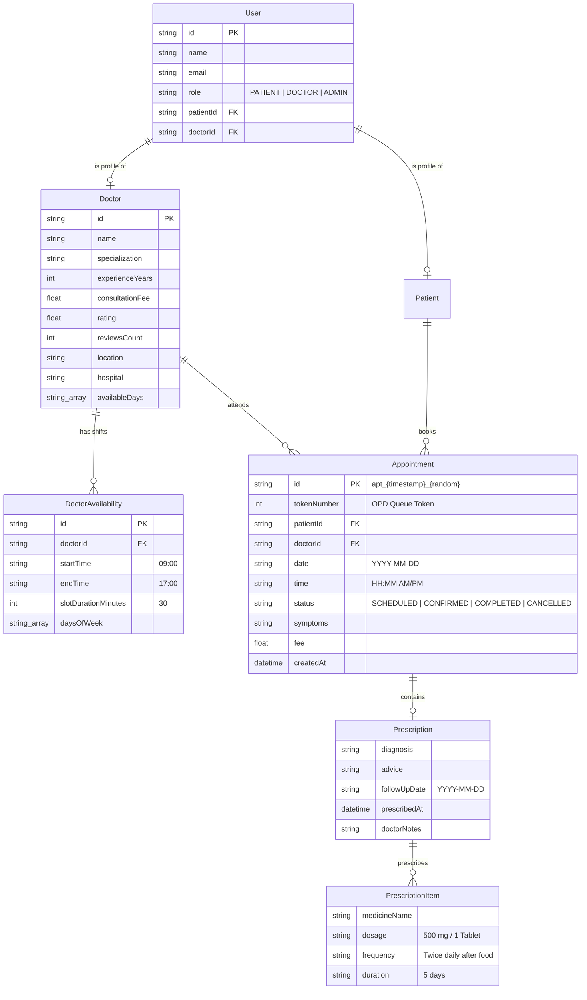

# 🗄️ Database & Domain Schema Specification

This document specifies the core domain models, field constraints, relationships, and data normalization rules in **Medrella HMS**.

---

## 1. Entity-Relationship Model

---

## 2. Field Dictionary & Constraints

### `Appointment`
| Field | Type | Required | Description & Constraints |
| :--- | :--- | :--- | :--- |
| `id` | `string` | Yes | Unique reference formatted as `apt_{timestamp}_{random}` |
| `tokenNumber` | `number` | Yes | Auto-incremented daily queue token per doctor per date ($1, 2, 3\dots$) |
| `patientId` | `string` | Yes | Foreign key to `User.patientId` |
| `patientName` | `string` | Yes | Full name of patient |
| `patientEmail`| `string` | Yes | Contact email |
| `doctorId` | `string` | Yes | Foreign key to `Doctor.id` |
| `doctorName` | `string` | Yes | Full title of attending physician |
| `doctorSpecialty`| `string`| Yes | Department specialization |
| `date` | `string` | Yes | Date in `YYYY-MM-DD` format |
| `time` | `string` | Yes | Time slot string e.g. `10:00 AM` |
| `status` | `enum` | Yes | `'SCHEDULED' \| 'CONFIRMED' \| 'COMPLETED' \| 'CANCELLED'` |
| `symptoms` | `string` | Yes | Primary clinical reason for appointment |
| `fee` | `number` | Yes | Consultation fee in USD |
| `prescription`| `Prescription`| No | Attached clinical prescription on completion |

### `Prescription`
| Field | Type | Required | Description |
| :--- | :--- | :--- | :--- |
| `diagnosis` | `string` | Yes | Doctor's diagnostic finding |
| `medicines` | `PrescriptionItem[]` | Yes | Array of prescribed medications |
| `advice` | `string` | No | Dietary, lifestyle, or recovery guidelines |
| `followUpDate` | `string` | No | Next suggested consultation date (`YYYY-MM-DD`) |
| `doctorNotes` | `string` | No | Physician internal notes (EHR) |
| `prescribedAt` | `string` | Yes | ISO 8601 timestamp of prescription sign-off |

---

## 3. Data Normalization Rules
To ensure backward and forward compatibility with legacy records and varying client payloads:
- `normalizeDoctor(d)` maps `specialty` $\leftrightarrow$ `specialization`, `fee` $\leftrightarrow$ `consultationFee`, `experience` $\leftrightarrow$ `experienceYears`, and `bio` $\leftrightarrow$ `about`.
- `normalizeAppointment(a)` ensures `tokenNumber` defaults to $1$ if missing, and aliases `timeSlot` $\leftrightarrow$ `time`.

