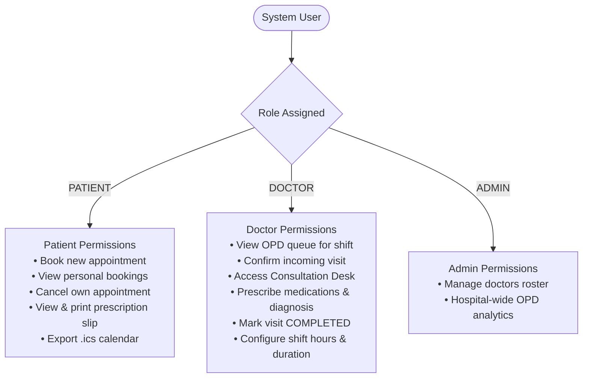

# 🛡️ Security, Access Control & Data Protection Specification

This document details the security principles, access control policies, input sanitization rules, and data handling standards for **Medrella HMS**.

---

## 1. Role-Based Access Control (RBAC)

Medrella defines three primary system roles:

### Role Enforcement Policies
1. **Patient Data Isolation**:
   - `GET /api/appointments?patientId=X` returns only appointments where `patientId === X`.
   - Patients cannot view other patients' medical details, symptoms, or prescription slips.
2. **Clinical Authority**:
   - Only users with role `DOCTOR` can create or modify `prescription` records during the completion of a consultation.
   - Patients cannot alter prescription fields or mark their own visits `COMPLETED`.
3. **Cancellation Constraints**:
   - An appointment marked `COMPLETED` is an immutable clinical record and **cannot** be cancelled.
   - An appointment marked `CANCELLED` cannot be re-completed without a new booking.

---

## 2. Input Validation & Data Sanitization

1. **Date Format Validation**:
   - All dates must conform strictly to `YYYY-MM-DD` (ISO 8601 calendar date).
   - Past dates are disabled on client date pickers (`min={todayStr}`).
2. **Time Slot Integrity**:
   - Time slots must match approved shift increments (e.g. `10:00 AM`).
   - Arbitrary text strings in time slots are rejected.
3. **Prescription Sanitization**:
   - Medicine rows with blank or whitespace-only names are filtered out before persistence.
   - HTML/script injection in `symptoms`, `diagnosis`, or `advice` fields is sanitized by React's automatic JSX text escaping.

---

## 3. Ephemeral Serverless Security & Secrets

1. **Zero Hardcoded Secrets**:
   - The application does not store database passwords, API tokens, or private keys in the client bundle or repository.
2. **Serverless Filesystem Protection**:
   - All persistent file writes are confined to `process.env.VERCEL ? '/tmp' : '.data'`.
   - Operating outside `/tmp` on serverless is prevented to eliminate filesystem corruption risks.
3. **PHI & Sensitive Data Protection**:
   - No mock passwords or social security numbers are stored.
   - Demo personas use standard synthetic test identities (`John Doe`, `Dr. Jane Smith`).

