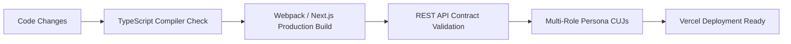

# 🧪 Quality Requirements & Testing Specification

This document defines the automated verification gates, REST API testing matrix, and 5 Critical User Journeys (CUJs) required for **Medrella HMS**.

---

## 1. Quality Gates (Must-Pass Before Any Release)



### Mandatory Execution Commands
```powershell
# 1. Typecheck & Production Build (0 errors allowed)
cd frontend
npm run build

# 2. Local Dev Server Health Check
curl.exe -I http://localhost:3000
# Must return: HTTP/1.1 200 OK
```

---

## 2. Five Critical User Journeys (CUJs)

### CUJ-1: Patient Discovery, Booking & Calendar Sync
- **Persona**: `John Doe` (`user_pat_1`)
- **Precondition**: Navigated to `/doctors`.
- **Steps**:
  1. Filter by specialty `Cardiology` or search `Dr. Jane Smith`.
  2. Click **Book Consultation**.
  3. Select tomorrow's date and pick an available slot (e.g. `10:00 AM`).
  4. Submit reason: *"Mild palpitations"*.
- **Verification**:
  - Modal transitions to Success screen displaying auto-assigned OPD token (e.g. `#OPD-01`).
  - Clicking **Add to Calendar (.ics)** downloads a valid `.ics` file containing doctor details and 30-min alarm.
  - Slot `10:00 AM` is immediately greyed out if another patient attempts to book it.

### CUJ-2: Double-Booking Collision Prevention (Negative Test)
- **Objective**: Guarantee server rejects duplicate booking on same slot.
- **Verification Script**:
```powershell
$body = @{ patientId='pat_1'; doctorId='doc_1'; date='2026-10-30'; time='10:00 AM'; timeSlot='10:00 AM'; symptoms='First' } | ConvertTo-Json
Invoke-RestMethod -Uri 'http://localhost:3000/api/appointments' -Method Post -Body $body -ContentType 'application/json'

# Attempt immediate duplicate booking:
$dupBody = @{ patientId='pat_2'; doctorId='doc_1'; date='2026-10-30'; time='10:00 AM'; timeSlot='10:00 AM'; symptoms='Collision Attempt' } | ConvertTo-Json
try {
  Invoke-RestMethod -Uri 'http://localhost:3000/api/appointments' -Method Post -Body $dupBody -ContentType 'application/json'
  Write-Error "Test Failed: Duplicate booking was incorrectly accepted!"
} catch {
  Write-Host "Test Passed: Duplicate slot booking rejected as expected."
}
```

### CUJ-3: Doctor OPD Desk & Live Queue Token
- **Persona**: `Dr. Jane Smith` (`user_doc_1`)
- **Precondition**: Navigated to `/doctor`.
- **Steps**:
  1. Observe **"NOW SERVING"** banner showing active patient (`John Doe`) and `#OPD-01`.
  2. Click **Consultation Desk & Rx**.
  3. Enter diagnosis: *"Stage 1 Pre-hypertension"*.
  4. Add medicine: *"Metoprolol Succinate 25mg"*, 1 Tablet, Once daily, 30 days.
  5. Add advice: *"Reduce sodium intake and keep daily BP log"*.
  6. Click **Save Rx & Complete Visit**.
- **Verification**:
  - Appointment moves from In Queue to **Completed**.
  - KPI counter for Completed increments by 1.

### CUJ-4: Patient Prescription Retrieval & Printable Medical Slip
- **Persona**: `John Doe` (`user_pat_1`)
- **Precondition**: Navigated to `/patient`.
- **Steps**:
  1. Filter by **Completed**.
  2. Locate the visit completed in CUJ-3.
  3. Click **Prescription Slip**.
- **Verification**:
  - Medical slip modal opens with hospital letterhead, doctor credentials, and Rx medicine table.
  - Clicking **Print Slip** invokes `window.print()` for instant PDF or paper printout.

### CUJ-5: Theme & Persona Responsive Switcher
- **Steps**:
  1. Toggle theme switch in navbar (`Sun` / `Moon`).
  2. Confirm entire page responds to dark background (`dark:bg-slate-900`) and high-contrast text.
  3. Reload browser -> confirm theme choice is preserved in `localStorage`.
  4. Switch persona between John Doe, Dr. Jane Smith, and Dr. Robert Chen -> confirm immediate data queue switch without page reload.

