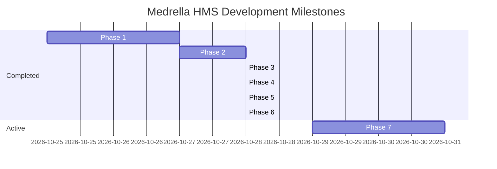

# 🗺️ Medrella HMS — Engineering Roadmap

This roadmap tracks the phased evolution of **Medrella Hospital Management System** from initial prototype to an intelligent clinical platform.

---

## Roadmap Phases & Progress

---

## Detailed Milestone Breakdown

### Phase 1: Core Foundation & UI ✅ (COMPLETED)
- Next.js 16.4 App Router, React 19, TypeScript 5.
- Tailwind CSS v4 setup with `@custom-variant dark` class toggling.
- Dark / Light mode tactile toggle with `localStorage` persistence.
- Persona Switcher (`John Doe`, `Dr. Jane Smith`, `Dr. Robert Chen`).
- Landing page with live OPD preview, specialty browser, and clinic showcase.

### Phase 2: Booking Engine & Conflict Prevention ✅ (COMPLETED)
- Dynamic doctor shift schedule reader.
- Conflict-free time slot generator ($O(1)$ set lookup).
- Client booking modal with real-time slot selection and symptom intake.
- Zero double-booking guarantee enforced at server API.

### Phase 3: Clinical Suite & OPD Queue ✅ (COMPLETED)
- Daily sequential OPD queue token generator (`#OPD-01`, `#OPD-02`).
- Doctor dashboard "Now Serving" banner with live active patient callout.
- Doctor Consultation Desk & dynamic Rx medication table (Name, Dosage, Frequency, Duration).
- Patient verified EHR printable medical slip (`window.print()`).
- One-click RFC 5545 `.ics` calendar sync for Google, Apple, and Outlook.

### Phase 4: Appointment Rescheduling & Slot Reallocation 🔄 (CURRENT SPRINT)
- Self-service "Reschedule Visit" modal in Patient Portal.
- Atomic slot swapping: frees old slot, reserves new slot, and reassigns OPD token.
- Collision prevention on rescheduling target slot.
- See `tasks/current-task.md` for complete specification.

### Phase 5: Doctor Leave & Shift Blackout ⏳ (UPCOMING)
- Doctor date blackout / vacation manager in `/doctor`.
- Immediate disabling of booking slots during approved leave dates without altering baseline weekly shifts.
- Emergency off notification for scheduled patients.

### Phase 6: AI Clinical Symptom Triage & Specialist Matcher ⏳ (UPCOMING)
- Interactive conversational triage assistant widget on landing page.
- Evaluates patient symptoms (e.g. *"chest pain radiating down left arm"*, *"persistent itchy eczema"*) and suggests:
  - Appropriate medical department (Cardiology vs Dermatology).
  - Urgency rating (Routine vs Urgent).
  - 1-click booking CTA pre-selecting the matched specialist.

### Phase 7: Doctor Detail Pages & Patient Reviews ⏳ (UPCOMING)
- Dedicated profile route `/doctors/[id]` with medical credentials, hospital affiliations, and consultation room details.
- Post-consultation patient review and 1–5 star rating submission.
- Real-time rating aggregation displayed across doctor discovery cards.

