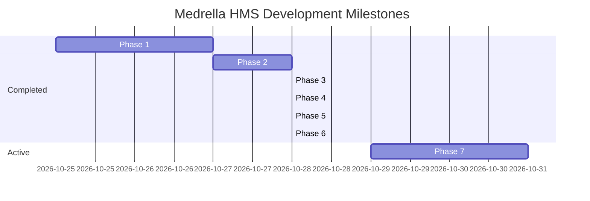

# 🗺️ Medrella HMS — Engineering Roadmap

This roadmap tracks the phased evolution of **Medrella Hospital Management System** from initial prototype to an intelligent clinical platform.

---

## Roadmap Phases & Progress

---

## Detailed Milestone Breakdown

### Phase 1: Core Foundation & UI ✅ (COMPLETED)
- Next.js 16.4 App Router, React 19, TypeScript 5.
- Tailwind CSS v4 setup with `@custom-variant dark` class toggling.
- Dark / Light mode tactile toggle with `localStorage` persistence.
- Persona Switcher (`John Doe`, `Dr. Jane Smith`, `Dr. Robert Chen`).
- Landing page with live OPD preview, specialty browser, and clinic showcase.

### Phase 2: Booking Engine & Conflict Prevention ✅ (COMPLETED)
- Dynamic doctor shift schedule reader.
- Conflict-free time slot generator ($O(1)$ set lookup).
- Client booking modal with real-time slot selection and symptom intake.
- Zero double-booking guarantee enforced at server API.

### Phase 3: Clinical Suite & OPD Queue ✅ (COMPLETED)
- Daily sequential OPD queue token generator (`#OPD-01`, `#OPD-02`).
- Doctor dashboard "Now Serving" banner with live active patient callout.
- Doctor Consultation Desk & dynamic Rx medication table (Name, Dosage, Frequency, Duration).
- Patient verified EHR printable medical slip (`window.print()`).
- One-click RFC 5545 `.ics` calendar sync for Google, Apple, and Outlook.

### Phase 4: Appointment Rescheduling & Slot Reallocation 🔄 (CURRENT SPRINT)
- Self-service "Reschedule Visit" modal in Patient Portal.
- Atomic slot swapping: frees old slot, reserves new slot, and reassigns OPD token.
- Collision prevention on rescheduling target slot.
- See `tasks/current-task.md` for complete specification.

### Phase 5: Doctor Detail Pages & Patient Reviews ✅ (COMPLETED)
- Dedicated profile route `/doctors/[id]` with medical credentials, hospital affiliations, and consultation room details.
- Post-consultation patient review and 1–5 star rating submission via `POST /api/doctors/[id]/reviews`.
- Real-time rating aggregation displayed across doctor discovery cards.

### Phase 6: Enterprise EMR Architecture: Patient, Doctor, and Admin Modules ✅ (COMPLETED)
- **Patient Module (`/patient`)**: Master Patient Index (MPI/MRN), Longitudinal EHR medical timeline, and Itemized Billing statements with receipts & online settlement.
- **Doctor Module (`/doctor`)**: Live 3-Stage OPD Triage Queue, 1-Click "Call Next Patient", SOAP Encounter with Vitals bedside entry, ICD-10 diagnosis presets, diagnostic lab orders, and e-Prescribing with multi-drug regimens.
- **Admin Module (`/admin`)**: Executive Operations Dashboard (revenue, footfall, staff metrics), Specialist Roster with Onboarding modal, Clinical Departments directory, Hospital Billing Ledger with status reconciliation, and Security Audit Trail.
- **Persona Switcher**: Seamless switching between John Doe (Patient), Dr. Jane Smith (Doctor), Dr. Robert Chen (Doctor), and Sarah Jenkins (Admin).

### Phase 7: Production-Ready Supabase Authentication & RBAC ✅ (COMPLETED)
- **Supabase SSR Integration**: Cookie-based authentication using `@supabase/ssr` (`createBrowserClient`, `createServerClient`).
- **Role-Based Access Control (RBAC)**: PostgreSQL `profiles` table with RLS policies and automatic trigger on sign up.
- **Next.js Route Protection Middleware**: Automatic token refresh and route guards (`/admin` for Admins, `/doctor` for Doctors, `/patient` for Patients).
- **Modern Auth UI**: Dedicated `/login` and `/signup` portals with Email/Password validation and 1-click **Demo Quick Login**.
- **Resilient Zero-Config Fallback**: Graceful fallback ensures build (`npm run build`) and preview testing never crash without `.env.local`.

### Phase 8: AI Clinical Symptom Triage & Specialist Matcher ⏳ (UPCOMING)
- Interactive conversational triage assistant widget on landing page.
- Evaluates patient symptoms (e.g. *"chest pain radiating down left arm"*, *"persistent itchy eczema"*) and suggests appropriate medical department, urgency rating, and 1-click booking CTA.

